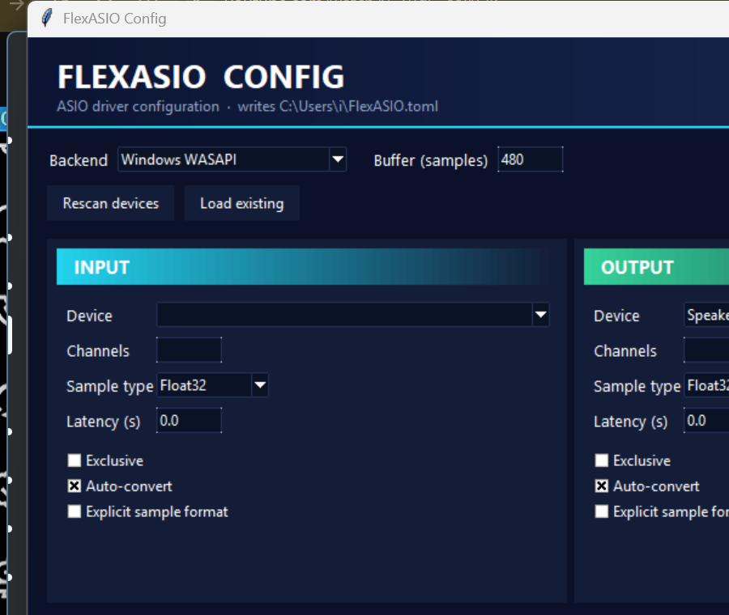

# FlexASIO Config GUI

A small native Windows GUI that generates and edits the
[FlexASIO](https://github.com/dechamps/FlexASIO) configuration file
(`FlexASIO.toml`). No editing TOML by hand in Notepad.



## What it does

[FlexASIO](https://github.com/dechamps/FlexASIO) is a universal ASIO driver
for Windows. It does **not** ship with a configuration file — you are expected
to write `FlexASIO.toml` yourself. That file controls which backend FlexASIO
uses (`Windows WASAPI`, `MME`, `DirectSound`, `WDM-KS`), which input/output
devices it opens, the buffer size, sample type and latency.

This tool gives that file a graphical interface:

- Runs the `PortAudioDevices.exe` program that ships with FlexASIO and reads
  back your **real** device list — no hand-typed device names.
- Lets you pick a backend, input device, output device, buffer size, sample
  type, latency hint and the WASAPI flags (exclusive mode, auto-convert,
  explicit sample format).
- Shows a live TOML preview as you change anything.
- **Save** writes `%USERPROFILE%\FlexASIO.toml` (UTF-8) and verifies the write.
  **Load** reads an existing config back into the form.

## Requirements

- Windows 10 or 11
- Python 3.8 or newer (tkinter is included in the standard library — no pip
  packages needed)
- [FlexASIO](https://github.com/dechamps/FlexASIO/releases) installed. The
  tool calls `PortAudioDevices.exe` from `C:\Program Files\FlexASIO\`.

## Run

```
python FlexASIO_Config_GUI.py
```

Or double-click `Start FlexASIO Config.cmd` (launches without a console
window).

## Usage

1. Pick a backend. `Windows WASAPI` is the recommended default. The others
   (MME, DirectSound, WDM-KS) are listed for completeness — note that MME
   truncates device names to 31 characters, which is a limitation of the MME
   API itself, not a bug here.
2. Pick your output device (it defaults to the system default output).
3. Set the input device to `(disabled)` if you only need playback — FlexASIO
   recommends half-duplex when possible.
4. Click **Save config**.

FlexASIO watches the file for changes and re-initialises automatically, so a
running DAW picks up the new settings without a restart.

## The config it writes

The output is a standard `FlexASIO.toml`. For example:

```toml
backend = "Windows WASAPI"
bufferSizeSamples = 480

[input]
device = ""

[output]
device = "Speakers (Senary Audio)"
sampleType = "Float32"
suggestedLatencySeconds = 0.0
```

Device names are written exactly as `PortAudioDevices.exe` reports them,
including non-ASCII characters (the file is UTF-8), so FlexASIO matches them
correctly.

## Notes

- This is an independent tool. It is not affiliated with the FlexASIO project.
- FlexASIO itself is by [dechamps](https://github.com/dechamps/FlexASIO).
- Device names must match `PortAudioDevices.exe` output exactly; this tool
  guarantees that by sourcing them directly from that program.

## License

MIT — see [LICENSE](LICENSE).
